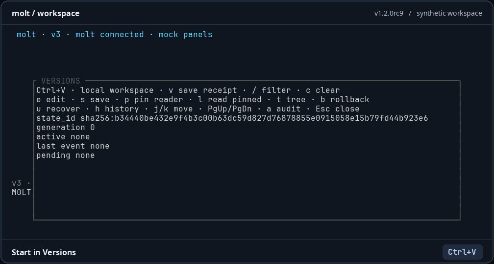

# molt

**Version your local AI agent workspace.**

molt lets you rerun a job with the same prompts, configuration, and tool
definitions after those files have changed.



*Recorded with the v1.2.0rc9 terminal UI and a synthetic workspace. No model account is needed for this workflow.*

[Workspace quickstart](docs/operations/project-quickstart.md) · [Linux x86_64 prerelease](https://github.com/FeiSaMa/molt/releases/tag/v1.2.0rc9) · [简体中文](README.zh-CN.md)

- **Save related files together.** Capture prompts, configs, and tool definitions in one snapshot.
- **Pin a snapshot for each run.** Give a job a fixed copy of its inputs, even when the active version changes.
- **Try changes on a branch.** Switch branches, merge changes, or roll back the active local version.
- **See what changed and why.** Inspect version history, save receipts, and audit records.
- **Recover after an interrupted save.** Look up the outcome using the original request ID.

## Try the Linux prerelease

[Download v1.2.0rc9](https://github.com/FeiSaMa/molt/releases/tag/v1.2.0rc9) · [Release notes](docs/releases/1.2.0rc9.md)

The single-user Linux x86_64 candidate (1.2.0rc9) includes a matched CLI, TUI and kernel.
With the archive and its checksum in the current directory, run:

```bash
sha256sum -c molt-1.2.0rc9-linux-x86_64.tar.gz.sha256
tar -xzf molt-1.2.0rc9-linux-x86_64.tar.gz
cd molt-1.2.0rc9-linux-x86_64
bash ./install-user.sh
"$HOME/.local/bin/molt" tui --mock
```

The installer needs uv, Python 3.12.13 and a systemd user manager. Ctrl+Q exits.
The command above runs Chat in offline mock mode. Settings, Diff and Approval
also use mock data in this prerelease.

To reproduce the recording, [start an isolated version workspace](docs/operations/version-cli.md#安装与首次运行)
and follow the [terminal UI walkthrough](docs/operations/version-cli.md#终端界面).

## Try a workspace from source

On Linux, the [workspace quickstart](docs/operations/project-quickstart.md) runs a
local example that saves a config and a prompt together, pins them for a job,
rolls back the active snapshot, and reads the reason for the change. The example
uses synthetic files and needs no model account.

## Run from source

The following steps start an isolated instance on Linux. You'll need
[uv](https://docs.astral.sh/uv/) and [Rust](https://rustup.rs/).

From the repository root:

```bash
PYTHONDONTWRITEBYTECODE=1 uv sync --locked --python 3.12.13
cargo build --locked -p molt-kernel
molt_workspace=$(mktemp -d /tmp/molt-XXXXXX)
target/debug/molt-kernel init --state "$molt_workspace/state"
printf 'Socket: %s\n' "$molt_workspace/state/kernel.sock"
target/debug/molt-kernel serve --state "$molt_workspace/state"
```

Leave the service running. In another terminal, return to the same repository and
set the socket path to the one printed above.

```bash
export MOLT_KERNEL_SOCKET=/tmp/molt-XXXXXX/state/kernel.sock
PYTHONDONTWRITEBYTECODE=1 uv run --locked molt inspect
PYTHONDONTWRITEBYTECODE=1 uv run --locked molt current
PYTHONDONTWRITEBYTECODE=1 uv run --locked molt audit
```

The [transaction example](docs/operations/external-integration.md) walks through
upload, commit, and lookup. If the outcome of a commit is unknown, use
`molt request-status` to look up the original request ID and reuse the same ID and
parameters during recovery.

## Read a snapshot from your program

After [starting an isolated project workspace](docs/operations/version-cli.md#项目级-cli),
run `molt project --config project.json read-tree` once per job. Pass the
returned `tree` to your program and retain `snapshot` alongside its output.
For example, `cat "$tree/prompt.txt"` reads the prompt from that export.
After a rollback, existing jobs can keep using their original exports.

## OpenCode project snapshots

Follow [installation and first run](docs/operations/version-cli.md#安装与首次运行)
to unpack the bundle and start an isolated workspace. Stop at
`test "$ready" = 1` and continue in the same Bash session.

```bash
mkdir -m 700 "$base/edit" "$base/exports"
cat > "$base/project.json" <<'JSON'
{"workspace":"w","edits":"edit","exports":"exports","files":["opencode.json"]}
JSON
p() { "$base/venv/bin/molt" project --config "$base/project.json" "$@"; }

edit=$(p begin | jq -er '.edit')
printf '%s\n' '{"model":"isolated/demo"}' > "$edit/opencode.json"
initial=$(p save --reason 'Save the trial baseline' | jq -er '.snapshot')

printf '%s\n' '{"model":"isolated/edited"}' > "$edit/opencode.json"
p preview
p save --reason 'Update the sample configuration' > "$base/edited.json"
v audit "$(jq -er '.event' "$base/edited.json")"

p rollback "$initial"
tree=$(p read-tree | jq -er '.tree')
cat "$tree/opencode.json"
```

The last command should print `{"model":"isolated/demo"}`. With OpenCode v2
installed, run `p opencode -- debug config` to see the configuration a new job
reads. The [project CLI guide](docs/operations/version-cli.md#项目级-cli) covers
save conflicts, request recovery, and launch options.

Use `molt version` for the underlying workspace and version commands. The
[workspace guide](docs/operations/version-cli.md) covers branching, merging,
pinned reads, and how an installed offline model can add a digest with
references to the original evidence. The
[source example](docs/operations/synthetic-versions.md) uses the same broker.

## Usage and maintenance

molt pairs a Python CLI with a Rust kernel that stores content-addressed objects
and version history. The CLI talks to the kernel over a Unix socket.

| Task | Documentation |
| --- | --- |
| Query, commit, audit, and recover transactions | [CLI reference](docs/operations/kernel-cli.md) |
| Build and install the Linux bundle or run a user service | [Linux packaging](docs/operations/v2-release-checklist.md) · [User service](docs/operations/molt-kernel-systemd.md) |
| Back up, verify, and restore into a new directory | [Backup and restore](docs/operations/v2-backup-restore.md) |
| Understand the kernel and client boundaries | [Architecture](docs/architecture.md) |
| Build and verify candidate packages | [Contributing](CONTRIBUTING.md) |

Use the [matching archived release](docs/operations/kernel-cli.md#旧状态归档) on a separate copy of v1 data.
Rollback changes local state. External operations keep their own transaction
and recovery lifecycle.

## Development

See [AGENTS.md](AGENTS.md) and [Contributing](CONTRIBUTING.md) for development
and review conventions.
