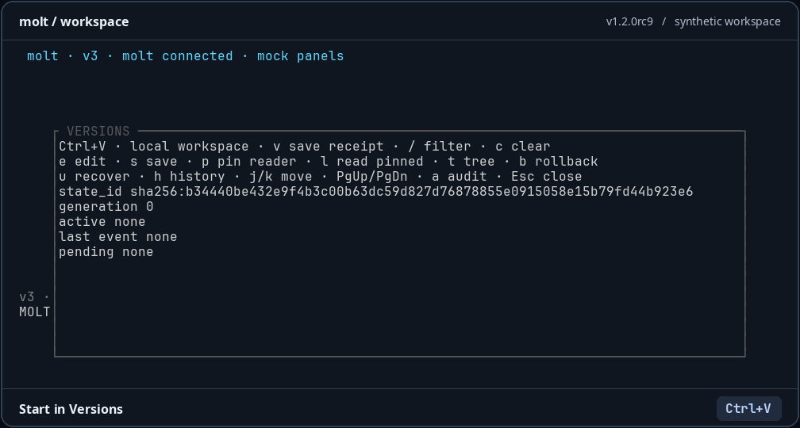

# molt

**给本地 AI Agent 工作区做版本管理。**

molt 帮你在提示词、配置或工具定义改动后，找回当时的文件并用同一组输入重新运行作业。



*使用上一版 v1.2.0rc9 终端界面和合成工作区录制，这套流程无需模型账号。*

[工作区快速开始](docs/operations/project-quickstart.md) · [独立试用记录模板](docs/operations/independent-trial.md) · [Linux x86_64 预发行版](https://github.com/FeiSaMa/molt/releases/tag/v1.2.0rc10) · [English](README.md)

- **成组保存文件。** 把提示词、配置和工具定义保存到同一个快照。
- **为每次运行固定输入。** 活动版本变更后，已启动的作业仍能读取原快照。
- **在分支上试改动。** 支持切换或合并分支，也可以回退本地活动版本。
- **查清改了什么、为什么改。** 查看版本历史、保存回执和审计记录。
- **恢复中断的保存。** 使用原 request ID 查询事务结果。

## 试用 Linux 预发行版

[下载 v1.2.0rc10](https://github.com/FeiSaMa/molt/releases/tag/v1.2.0rc10) · [发行说明](docs/releases/1.2.0rc10.md)

Linux x86_64 单用户候选版（1.2.0rc10）以 deb、rpm 和 Arch 原生包提供配套的 CLI、TUI 与 kernel。请下载对应发行版的包和 `SHA256SUMS`，校验后安装：

```bash
sha256sum --check --ignore-missing SHA256SUMS

# Arch Linux
sudo pacman -U ./molt-1.2.0rc10+git3e7d01b-1-x86_64.pkg.tar.zst
# Debian / Ubuntu
sudo apt install ./molt_*.deb
# Fedora / RHEL
sudo dnf install ./molt-*.rpm
```

rc10 包未签名。发布声明与打包元数据要求 glibc 2.43+、Python 3.11+；本轮文档更新未重新实测。`molt tui --mock` 以离线模拟模式启动 Chat，此预发行版的 Settings、Diff 和 Approval 也使用模拟数据。

v1.2.0rc9 的 tar.gz 与校验文件作为[上一版可移植归档](https://github.com/FeiSaMa/molt/releases/tag/v1.2.0rc9)保留（[rc9 发行说明](docs/releases/1.2.0rc9.md)），不是当前安装入口。

要复现演示，先[启动独立版本工作区](docs/operations/version-cli.md#安装与首次运行)，再按[终端界面操作步骤](docs/operations/version-cli.md#终端界面)操作。

## 从源码试用项目工作区

[工作区快速开始](docs/operations/project-quickstart.md) 在 Linux 上演示成组保存配置和提示词、
为作业固定快照、回退活动版本和查询变更理由。示例使用合成文件，无需模型账号。

## 从源码启动

下面的步骤在 Linux 上启动一个独立实例。需要 [uv](https://docs.astral.sh/uv/) 和 [Rust](https://rustup.rs/)。

在仓库根目录运行：

```bash
PYTHONDONTWRITEBYTECODE=1 uv sync --locked --python 3.12.13
cargo build --locked -p molt-kernel
molt_workspace=$(mktemp -d /tmp/molt-XXXXXX)
target/debug/molt-kernel init --state "$molt_workspace/state"
printf 'Socket: %s\n' "$molt_workspace/state/kernel.sock"
target/debug/molt-kernel serve --state "$molt_workspace/state"
```

保留服务终端，在另一个终端从同一源码目录运行，使用上一条命令显示的 socket 路径：

```bash
export MOLT_KERNEL_SOCKET=/tmp/molt-XXXXXX/state/kernel.sock
PYTHONDONTWRITEBYTECODE=1 uv run --locked molt inspect
PYTHONDONTWRITEBYTECODE=1 uv run --locked molt current
PYTHONDONTWRITEBYTECODE=1 uv run --locked molt audit
```

要尝试一次完整的上传、提交和查询，跟随[事务示例](docs/operations/external-integration.md)。提交结果未知时，先用 `molt request-status` 查询原 request ID，恢复时复用原 ID 和参数。

## 版本管理与模型审计

安装后使用 `molt version` 初始化个人工作区、提交自己的配置与内置 echo 工具描述、切换或合并分支、回退活动版本。运行可以固定到已提交的快照。审计保留原始记录，已安装的离线模型可追加引用原始字段的摘要。独立安装、首次提交和断线恢复命令见[个人工作区手册](docs/operations/version-cli.md)。[源码示例](docs/operations/synthetic-versions.md)使用同一 broker。

### 让普通程序固定读取快照

[启动独立项目工作区](docs/operations/version-cli.md#项目级-cli)后，每个新作业调用一次
`molt project --config project.json read-tree`。程序使用返回的 `tree` 读取文件，
把 `snapshot` 随结果保存。例如用 `cat "$tree/prompt.txt"` 读取固定的提示词。
活动版本回退后，已经启动的作业可以继续使用原来的导出。

### OpenCode 项目快照

先按[安装与首次运行](docs/operations/version-cli.md#安装与首次运行)解包并启动独立工作区。执行到 `test "$ready" = 1` 为止，在同一个 Bash 会话继续。

```bash
mkdir -m 700 "$base/edit" "$base/exports"
cat > "$base/project.json" <<'JSON'
{"workspace":"w","edits":"edit","exports":"exports","files":["opencode.json"]}
JSON
p() { "$base/venv/bin/molt" project --config "$base/project.json" "$@"; }

edit=$(p begin | jq -er '.edit')
printf '%s\n' '{"model":"isolated/demo"}' > "$edit/opencode.json"
initial=$(p save --reason '建立试用基线' | jq -er '.snapshot')

printf '%s\n' '{"model":"isolated/edited"}' > "$edit/opencode.json"
p preview
p save --reason '更新样例配置' > "$base/edited.json"
v audit "$(jq -er '.event' "$base/edited.json")"

p rollback "$initial"
tree=$(p read-tree | jq -er '.tree')
cat "$tree/opencode.json"
```

回退后最后一条命令应显示 `{"model":"isolated/demo"}`。已安装 OpenCode v2 时，可运行 `p opencode -- debug config` 查看新作业读取的配置。保存冲突、原请求恢复和启动参数见[项目级 CLI 手册](docs/operations/version-cli.md#项目级-cli)。

## 使用与维护

Python CLI 通过 Unix socket 访问 Rust kernel。kernel 负责保存内容寻址对象和版本历史。

| 目标 | 文档 |
| --- | --- |
| 查询、提交、审计和事务恢复 | [CLI 参考](docs/operations/kernel-cli.md) |
| 安装并常驻运行 | [构建 Linux 安装包](docs/operations/v2-release-checklist.md) · [用户服务](docs/operations/molt-kernel-systemd.md) |
| 备份、校验以及恢复到新目录 | [备份与恢复](docs/operations/v2-backup-restore.md) |
| 了解后端模块与边界 | [架构](docs/architecture.md) |
| 构建候选安装包与本地验证 | [贡献指南](CONTRIBUTING.md) |

使用[对应的历史发行归档](docs/operations/kernel-cli.md#旧状态归档)处理旧数据副本。外部业务写入有自己的事务和生命周期。molt 的回退仅切换本地状态。

## 开发

开发与审阅约定见 [AGENTS.md](AGENTS.md) 和 [贡献指南](CONTRIBUTING.md)。
